# Refnivo UI/UX redesign: final report (26 Nov 2026)

This report closes the redesign that was planned in [`REDESIGN_PLAN.md`](REDESIGN_PLAN.md) and approved on 25 Nov 2026.

- The redesign ran in 7 phases, from `06faa7c` to `2d67b01`.
- Every phase was pushed only after the owner said "push".
- Scope: 119 files changed (+2,932 / −1,882 lines), 29 of them pages.
- No route was removed, no database schema changed, and no server validation changed.

## 1. Problems found (summary of the audit)

The full table, with file references, is in `REDESIGN_PLAN.md` §2.

| Area | Main problems |
| --- | --- |
| Navigation & homepage | Explore Campaigns was hidden under "Resources". The header had six items and two dropdowns. The homepage had 11 sections that repeated the same message. |
| Onboarding | The first profile form had 19 fields for brands and 28 for creators, although only about 5 are required. |
| Dashboards | The overviews had 8 KPI cards that were all zero for new accounts, and nothing listed what needed action. The sidebars had 15–17 flat items with labels that sounded alike. |
| Campaigns | Public `/campaigns` and creator Discover used two different cards and filter sets. On phones the filters filled the whole first screen. The wizard had 7 steps. After applying, a creator could not see the application status on the campaign page. |
| Design system | About 400 raw colour classes caused shades to drift between pages. The error page offered no way out. Some indicators used colour alone. |
| Accessibility | Phone tables scrolled sideways. The focus outline was faint. There was no skip link, and several pages had no `<main>`. The image-upload label was not linked to any control. |

## 2. Improvements by phase

| Phase | What changed |
| --- | --- |
| 1. Design system | 326 raw colour classes moved to tokens, with no visible palette change. Added `success-strong`, `warning-strong`, `brand-from` and `brand-to`. One shared `CampaignCard`. Error boundaries now offer Retry, a safe page and Support. Added `docs/DESIGN_SYSTEM.md`. |
| 2. Navigation & homepage | New hero headline. 4-item header: For Brands, For Creators, Explore Campaigns, Pricing. The other pages moved to the footer and the mobile "More" menu. Homepage cut from 11 to 9 sections. The three products are now tabs (`/#affiliate`, `/#ugc` and `/#partners` still work). Live campaigns use real data. |
| 3. Onboarding | Essential fields come first; everything else sits in a "More details (optional)" group. Fields shown: brand 19 → 10, creator 28 → 8, customer 12 → 7. Server-side required fields are unchanged. |
| 4. Dashboards | Grouped sidebars (Grow / Results / Money / Account, and the creator and customer equivalents); no page removed. Brand overview: getting-started checklist, "Needs your attention" list and 4 KPIs. Creator overview: earnings strip and recommended campaigns. Customer overview: rewards summary and "Products you can share". |
| 5. Campaign experience | One campaign browser for `/campaigns` and Discover. It has 6 filters, 4 sort chips, a live count and Load more, and every view is a shareable URL that works without JavaScript. Phones get a Filters bottom sheet. The wizard went from 7 steps to 4, with Edit links on the review step. The campaign page gained an "At a glance" summary and an application status banner. |
| 6. Responsive & accessibility | 15 tables become cards on phones. 2 px focus ring. Skip link and `<main>` landmark on every layout. Charts have screen-reader summaries. Campaign page and wizard skeletons. Image upload is accessible and held while uploading. The e2e suite was repaired. |
| 7. Testing & report | Full regression (§6) and this report. CI now runs `next typegen` before the typecheck; the typecheck had been failing in CI because `next-env.d.ts` is not committed. |

## 3. Pages changed

- **Marketing**
  - `/`, `/campaigns`, `/campaigns/[slug]` (and its loading screen), `/get-started`
  - the header, footer and mobile menu on every marketing page
  - the 404 page and the marketing error page
- **Onboarding:** `/onboarding/profile` (brand, creator and customer forms), plus Edit profile in all three dashboards.
- **Brand dashboard:** overview, new campaign (wizard and its loading screen), analytics, billing, orders, partners, partner detail, payouts and wallet.
- **Creator dashboard:** overview, Discover, analytics and UGC.
- **Customer dashboard:** overview.
- **All dashboards:** grouped sidebar, `<main>` landmark, and loading text for screen readers.

## 4. Components and modules

**Added**

- `components/campaigns/campaign-browser.tsx` and `components/campaigns/campaign-filter-bar.tsx`: shared discovery UI.
- `components/marketing/home/product-tabs.tsx`: the tabbed products section.
- `components/dashboard/overview-blocks.tsx`: checklist and "Needs your attention" list.
- `components/system/error-state.tsx`: shared error boundary content.
- `lib/campaigns/filters.ts`: filter parsing; unknown values are ignored.
- `lib/campaigns/wizard-steps.ts`: the 4-step map.
- `lib/services/dashboard.ts`: read-only overview queries.
- New props on existing components:
  - `Table` `stackOnMobile`;
  - `ImageUpload` `id` / `invalid`;
  - `ChartSummary` in `components/charts/charts.tsx`.
- Tests: `tests/integration/dashboard.test.ts` and `tests/unit/campaign-wizard-steps.test.ts`.

**Removed (approved)**

- Superseded by the shared browser: `campaign-directory.tsx`, `campaign-directory-card.tsx` and `lib/services/directory.ts`. With them went the old directory's A–Z and category sorts and its broad category chips.
- Homepage: the standalone comparison table and the separate product-card row (decision 3).
- Unused marketing components: `hero-section`, `demo-dashboard`, `landing-visuals`, `launch-section`, `launch-video` and `trusted-brands`.

## 5. Functionality preserved

- **Routes:** every route that existed before the redesign still exists, and every former header page can be reached from the footer or the mobile menu.
- **Dashboards:**
  - Brand still has 17 sidebar entries and creator still has 15.
  - Overview numbers that left the overview are on Analytics.
  - On plans without Analytics they stay on the overview under "Performance".
- **Forms:** onboarding and the wizard submit the same fields, through the same schemas and server validation. Optional fields inside the closed group are still saved.
- **Money and attribution:** no change to the ledger, conversions, payouts, wallet or `/r/[code]` logic.
- **Honesty rules:**
  - No invented metrics, testimonials or screenshots.
  - Example cards stay labelled "Example".
  - Creator social numbers stay self-reported and are never shown to customers.

## 6. Test results (26 Nov 2026)

| Check | Result |
| --- | --- |
| GitHub CI on `2d67b01` (lint with zero warnings, typecheck, unit + integration tests, production build) | ✅ green |
| GitHub CI e2e (Playwright) | ✅ 16/16 |
| Local `vitest run` (Phase 7 rerun) | ✅ 53 files, 452/452 tests |
| Production sitemap: every URL fetched | ✅ 37/37 return 200; signed-out dashboard URLs redirect to log in; unknown URLs return 404 |
| Production console: `/`, `/campaigns`, `/pricing`, `/get-started`, `/auth/login` | ✅ no errors |
| 375 px horizontal-scroll check | ✅ 22 pages clean |
| 768 px horizontal-scroll check | ✅ 11 pages clean |
| Keyboard-only walk-through: home → campaign → sign up → onboarding → apply | ✅ passed; the apply dialog keeps focus inside |

## 7. Screenshots

These were taken on `localhost` with the seeded demo accounts. Every figure is demo data, and the dashboards show the "Demo data" banner.

| Desktop 1280 px | Phone 375 px |
| --- | --- |
| 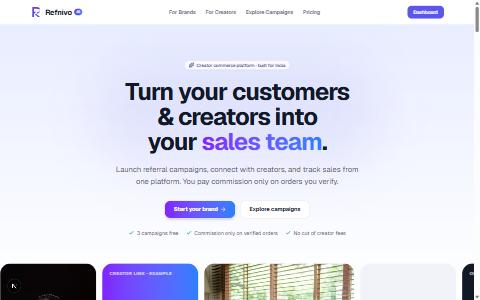 | 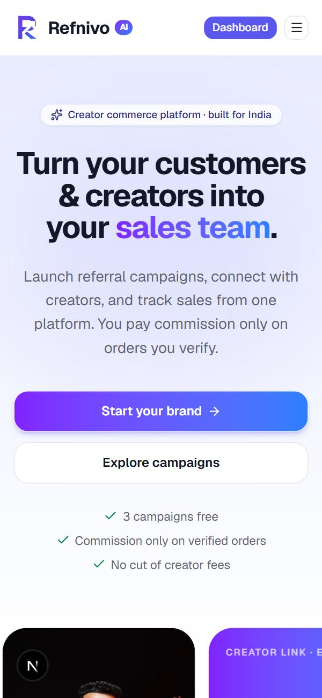 |
| 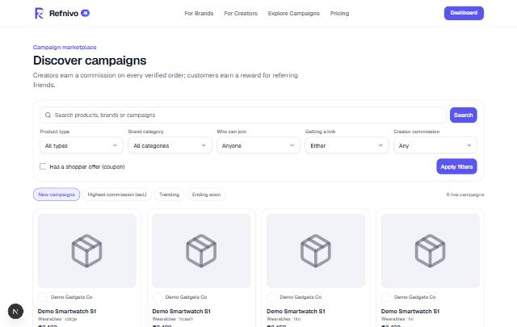 | 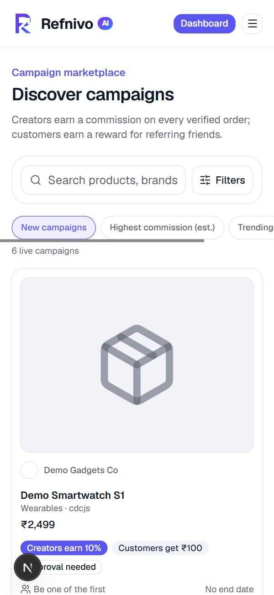 |
| 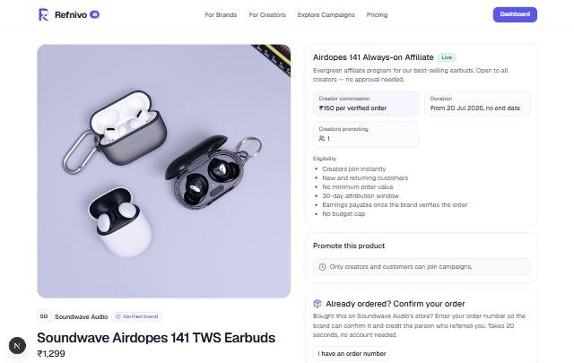 | 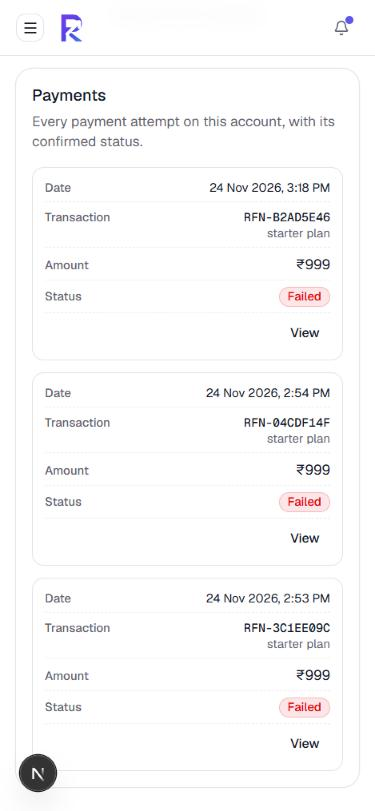 |
| 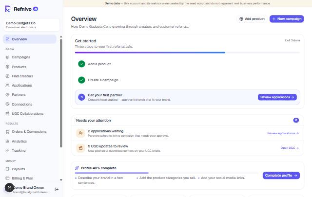 | 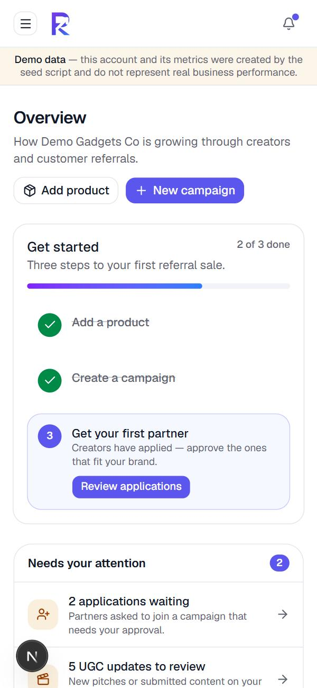 |
| 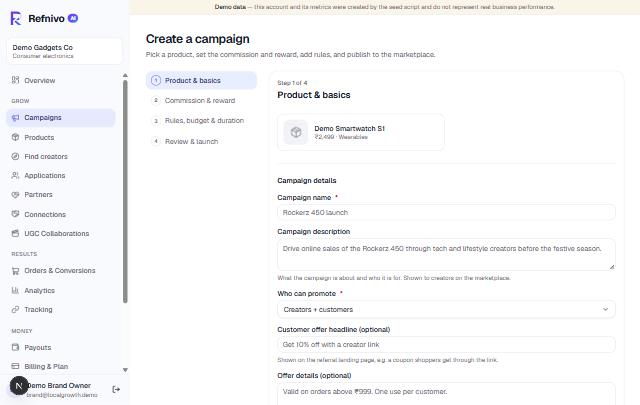 | 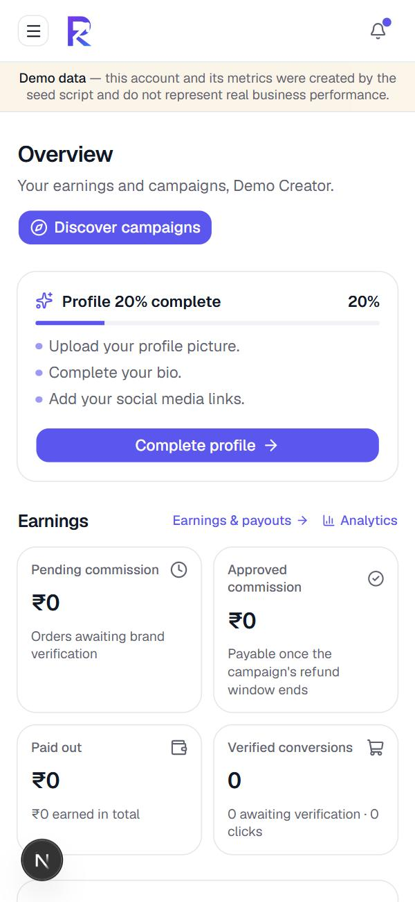 |
| 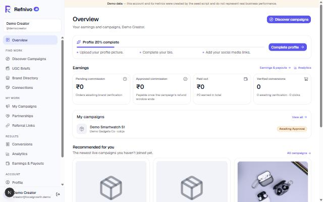 | 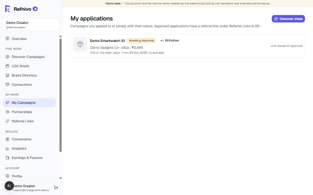 |

## 8. Open issues

1. **Skip link after client navigation.** After a client-side page change, the first Tab goes to the header instead of the skip link, because Next.js keeps the focus start point. It works on every full page load.
2. **Admin tables** still scroll sideways on phones. Admin is used on desktop, so `stackOnMobile` was not applied there.
3. **U3, real dashboard screenshots on the homepage,** is deferred until a demo account has realistic data that is labelled as such. The labelled "Example" cards stay until then.
4. **The customer overview was not opened in a browser,** because the customer demo login fails against the local database (the password does not match the seed). It is covered by typecheck and integration tests.
5. **One vitest test failed once and could not be identified.** The run did not capture the test's name, and every later run (including Phase 7) passed 452/452. If it fails again in CI, note the name and stabilise that test.
6. **Not measured:** the Lighthouse accessibility score (the plan's ≥ 95 target for Phase 2). The manual checks in §6 passed, but no Lighthouse run was recorded.
